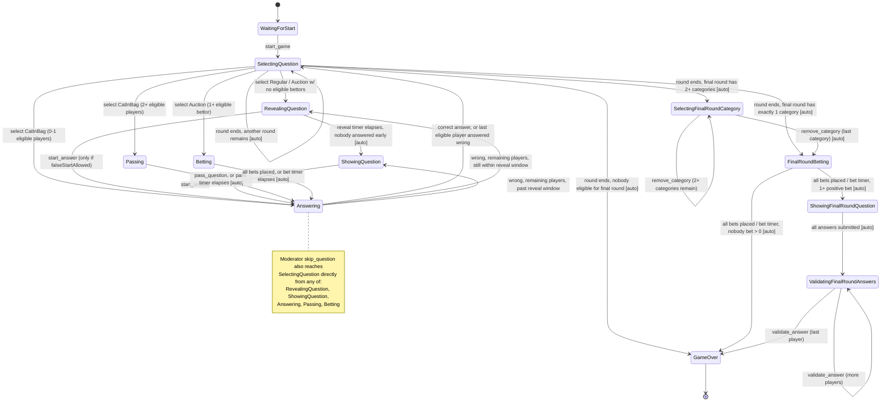

# CLAUDE.md

This file provides guidance to Claude Code (claude.ai/code) when working with code in this repository.

## Project Overview

**sgame** is a multiplayer quiz game (Jeopardy-style) with a Go backend and Next.js frontend. Players join rooms, a host selects questions from packs, and players answer/bet in real time over WebSocket.

## Commands

### Backend (`backend/`)

```bash
# Hot-reload dev server (uses air)
air

# Run directly
go run ./cmd/server/main.go

# Attachment processor (raw→compressed transcode service, triggered by
# storage notifications on the raw bucket)
go run ./cmd/attachment-processor/main.go

# Build
CGO_ENABLED=0 go build -o ./tmp/main ./cmd/server/main.go

# Unit tests
go test ./... -v

# Single test
go test ./internal/domain/... -run TestFunctionName -v

# E2E tests (starts testcontainers; requires Docker)
go test ./test/e2e/... -v -race -timeout 120s

# E2E subset
go test ./test/e2e/ -run TestPubSub -v
go test ./test/e2e/ -run TestStream -v
go test ./test/e2e/ -run TestRoom -v

# Regenerate Wire DI (after changing wire.go)
go generate ./internal/app/...

# Regenerate Swagger docs (after changing handler annotations)
swag init -g cmd/server/main.go -o docs --parseDependency --parseInternal --requiredByDefault
```

### Frontend (`frontend/`)

```bash
npm run dev        # dev server on :3000
npm run build
npm run lint
npm run lint:fix
```

### Full stack

```bash
cp .env.template .env   # fill in values first
docker-compose -f docker-compose.dev.yaml up --build
```

## Backend Architecture

### Layered structure

```
internal/
  domain/         Pure domain types and state-machine logic (no I/O)
  service/        Business logic; orchestrates domain + infrastructure
  interface/      Go interfaces for repository, cache, realtime, storage, queue
  infrastructure/ Concrete implementations:
    database/mongo/      MongoDB repositories
    cache/redis/         Redis session & room cache, SIQ import slot limiter
    realtime/pubsub/     Redis Pub/Sub multiplexer
    realtime/streams/    Redis Streams multiplexer
    realtime/ws/         WebSocket channel wrapper
    storage/             GCS and Minio adapters (+ factory/); two buckets: raw (staging) and compressed (serving)
    queue/               Pull consumers for raw-bucket upload notifications (+ factory/): GCS Pub/Sub pull subscription, or a Redis-list-backed reliable queue fed by Minio's Redis notification target
  transport/
    http/          Gin HTTP controllers (auth, user, pack, pack_draft, room)
    ws/            WebSocket handlers (lobby, room)
  eventsprocessor/
    server/        Internal server-side event processors (one per room event type)
    client/        Per-connection event processors (RoomEventsProcessor, LobbyEventsProcessor)
  app/             Wire DI setup (wire.go → wire_gen.go) and app startup (app.go)
  config/          Env-based config loaded at startup
  message/         Shared Message struct {Id, Event, Payload}
pkg/
  custerr/         Typed HTTP errors (400/401/403/404/409/429/500)
  custvalid/       Custom gin/validator tags
  envvar/          Env var helpers
  sets/            Generic set type
```

### Dependency injection

Google Wire is used. The canonical wiring is in `internal/app/wire.go`. After any change to provider signatures, run `go generate ./internal/app/...` to regenerate `wire_gen.go`. Never edit `wire_gen.go` by hand.

### Real-time multiplexing

The server maintains two Redis multiplexers injected as three typed channel getters:

| Type                             | Implementation                           | Use                                                            |
| -------------------------------- | ---------------------------------------- | -------------------------------------------------------------- |
| `PubSubChannelGetter`            | `pubsub.Manager`                         | Lobby broadcast; room server channel for notifying clients     |
| `StreamsChannelGetter`           | `streams.StreamManager` (non-persistent) | Room broadcast stream; spectators start from `$`               |
| `PersistentStreamsChannelGetter` | `streams.StreamManager` (persistent)     | Room internal events; late joiners resume from stored `lastId` |

Both managers multiplex a single Redis connection across N Go subscribers. When the last subscriber on a channel leaves, the manager unsubscribes from Redis automatically.

### Room state machine

The `domain.Room` struct is the core entity. All state transitions are pure functions in `internal/domain/room.go`. The 12 states are:

Special question types alter the normal flow: **CatInBag** goes to `Passing`; **Auction** goes to `Betting` — both then converge to `Answering`.

Timer-driven transitions (reveal timer, betting timer, pass timer) are triggered by `RoomInternalEventsProcessor`, which runs per room as a goroutine. On server restart, `app.Start()` recovers ownership of existing rooms from the cache and re-spawns these goroutines.

### State Transition Diagram

This diagram (and the precondition table below it) is verified directly against every `r.State =` assignment in `internal/domain/room.go` — not simplified. A few edges are easy to miss from reading the domain code casually: `RevealingQuestion → Answering` only exists when `Options.FalseStartAllowed` is true; a wrong answer can return to _either_ `RevealingQuestion` or `ShowingQuestion` depending on timing, not just `ShowingQuestion`; `SelectingFinalRoundCategory` is skipped entirely (straight to `FinalRoundBetting`) when the final round has exactly one category; and `FinalRoundBetting → GameOver` is reachable directly if nobody places a positive bet.



Moderator `skip_round` is a manual, synchronous bypass of the "round ends" auto-advance logic — from `SelectingQuestion` only, it produces the same set of outcomes as the `[auto]` round-end edges above (`SelectingQuestion→SelectingQuestion`/`SelectingFinalRoundCategory`/`FinalRoundBetting`/`GameOver`), just triggered on demand instead of after `AnyAvailableQuestions()` turns false.

#### Every edge, with exact preconditions and source

| From                                                                  | To                                                                               | Trigger / precondition                                                                                                                                                                                                                                        | Source                                                                                                    |
| --------------------------------------------------------------------- | -------------------------------------------------------------------------------- | ------------------------------------------------------------------------------------------------------------------------------------------------------------------------------------------------------------------------------------------------------------- | --------------------------------------------------------------------------------------------------------- |
| `WaitingForStart`                                                     | `SelectingQuestion`                                                              | `start_game`, always (round 0)                                                                                                                                                                                                                                | `StartGame` → `StartNextRegularRound`, `room.go:167-186`                                                  |
| `SelectingQuestion`                                                   | `SelectingQuestion`                                                              | round exhausted, next regular round exists                                                                                                                                                                                                                    | `StartNextRegularRound`, `room.go:186`, called from `question_ended.go` (async) or `skip_round.go` (sync) |
| `SelectingQuestion`                                                   | `RevealingQuestion`                                                              | select Regular; or select Auction with zero players having `Score > 0`                                                                                                                                                                                        | `SelectQuestion`→`revealRegularQuestion`, `room.go:224-229,245-260,267-276`                               |
| `SelectingQuestion`                                                   | `Passing`                                                                        | select CatInBag, 2+ other connected players                                                                                                                                                                                                                   | `SelectQuestion`, `room.go:230-244`                                                                       |
| `SelectingQuestion`                                                   | `Answering`                                                                      | select CatInBag, 0 or 1 other connected players (skips `Passing` entirely)                                                                                                                                                                                    | `SelectQuestion`→`startNonRegularQuestion`, `room.go:230-240,289-301`                                     |
| `SelectingQuestion`                                                   | `Betting`                                                                        | select Auction, 1+ player with `Score > 0`                                                                                                                                                                                                                    | `SelectQuestion`, `room.go:245-254`                                                                       |
| `SelectingQuestion`                                                   | `SelectingFinalRoundCategory`                                                    | round exhausted, final round has 2+ available categories                                                                                                                                                                                                      | `StartFinalRound`, `room.go:580-587`                                                                      |
| `SelectingQuestion`                                                   | `FinalRoundBetting`                                                              | round exhausted, final round has exactly 1 available category — `StartFinalRound` sets `SelectingFinalRoundCategory` then immediately calls `chooseFinalRoundCategory` in the same transaction, so `SelectingFinalRoundCategory` is never externally observed | `StartFinalRound`→`chooseFinalRoundCategory`, `room.go:580-588,639-656`                                   |
| `SelectingQuestion`                                                   | `GameOver`                                                                       | round exhausted, no player has `Score > 0` (nobody eligible for final round)                                                                                                                                                                                  | `StartFinalRound` returns `false`, caller calls `EndGame`, `room.go:571-572`                              |
| `RevealingQuestion`                                                   | `ShowingQuestion`                                                                | reveal timer elapses with nobody answering early                                                                                                                                                                                                              | `StartRegularQuestion`, `room.go:278-287`, triggered by `revealing_started.go` deferred timer             |
| `RevealingQuestion`                                                   | `Answering`                                                                      | `start_answer`, only permitted if `Options.FalseStartAllowed == true`                                                                                                                                                                                         | `StartAnswer`, `room.go:303-317,347`                                                                      |
| `ShowingQuestion`                                                     | `Answering`                                                                      | `start_answer`, always permitted                                                                                                                                                                                                                              | `StartAnswer`, `room.go:303-317,347`                                                                      |
| `Passing`                                                             | `Answering`                                                                      | `pass_question` (moderator or current player), or pass timer elapses                                                                                                                                                                                          | `PassQuestion`/`PassQuestionAuto`→`startNonRegularQuestion`, `room.go:420-464`                            |
| `Betting`                                                             | `Answering`                                                                      | last eligible bettor places a bet, or bet timer elapses                                                                                                                                                                                                       | `PlaceBet`/`PlaceBetsAuto`→`startNonRegularQuestion`, `room.go:463-533`                                   |
| `Answering`                                                           | `SelectingQuestion`                                                              | correct answer, or wrong answer but `AllowedToAnswer` is now empty                                                                                                                                                                                            | `ValidateAnswer`→`EndQuestion`, `room.go:390-397,535-542`                                                 |
| `Answering`                                                           | `RevealingQuestion`                                                              | wrong answer, players remain, answering player's timer started before the question's reveal-timer start                                                                                                                                                       | `ValidateAnswer`→`continueRegularQuestion`, `room.go:404-412`                                             |
| `Answering`                                                           | `ShowingQuestion`                                                                | wrong answer, players remain, answering player's timer started at/after the reveal-timer start                                                                                                                                                                | `ValidateAnswer`→`continueRegularQuestion`, `room.go:404,413-415`                                         |
| `RevealingQuestion`/`ShowingQuestion`/`Answering`/`Passing`/`Betting` | `SelectingQuestion`                                                              | moderator `skip_question` — bypasses the normal per-state resolution and force-ends the current question                                                                                                                                                      | `SkipQuestion`→`EndQuestion`, `room.go:786-800`                                                           |
| `SelectingFinalRoundCategory`                                         | `SelectingFinalRoundCategory`                                                    | `remove_category`, 2+ categories remain available                                                                                                                                                                                                             | `RemoveFinalRoundCategory`, `room.go:601-637`                                                             |
| `SelectingFinalRoundCategory`                                         | `FinalRoundBetting`                                                              | `remove_category`, exactly 1 category remains                                                                                                                                                                                                                 | `RemoveFinalRoundCategory`→`chooseFinalRoundCategory`, `room.go:630-635,652`                              |
| `FinalRoundBetting`                                                   | `ShowingFinalRoundQuestion`                                                      | all bets placed / bet timer elapses, at least one player bet `> 0`                                                                                                                                                                                            | `PlaceFinalRoundBet`/`PlaceFinalRoundBetsAuto`→`startFinalRoundQuestion`, `room.go:658-722`               |
| `FinalRoundBetting`                                                   | `GameOver`                                                                       | all bets placed / bet timer elapses, every bet is `0`                                                                                                                                                                                                         | `startFinalRoundQuestion` finds zero eligible players → `EndGame`, `room.go:702-713`                      |
| `ShowingFinalRoundQuestion`                                           | `ValidatingFinalRoundAnswers`                                                    | last remaining player submits their final-round answer                                                                                                                                                                                                        | `SubmitFinalRoundAnswer`→`EndFinalRoundQuestion`, `room.go:725-751`                                       |
| `ValidatingFinalRoundAnswers`                                         | `ValidatingFinalRoundAnswers`                                                    | `validate_answer`, more final-round players remain to validate                                                                                                                                                                                                | `ValidateFinalRoundAnswer`, `room.go:753-784`                                                             |
| `ValidatingFinalRoundAnswers`                                         | `GameOver`                                                                       | `validate_answer`, last player validated                                                                                                                                                                                                                      | `ValidateFinalRoundAnswer`→`EndGame`, `room.go:777-781`                                                   |
| `SelectingQuestion` (only)                                            | `SelectingQuestion`/`SelectingFinalRoundCategory`/`FinalRoundBetting`/`GameOver` | moderator `skip_round` — manual, synchronous version of the round-end auto-advance edges above                                                                                                                                                                | `SkipRound`, `skip_round.go`, `room.go:802-813`                                                           |
| `GameOver`                                                            | —                                                                                | terminal, no outgoing transitions                                                                                                                                                                                                                             | `EndGame`, `room.go:949-960`                                                                              |

### WebSocket connection flow

1. HTTP `GET /api/ws/room/:id` — authenticated via session cookie
2. `RoomHandler.connect` calls `roomService.Connect`, sends initial `room_updated` state snapshot to the client
3. A `RoomEventsProcessor` is created for the connection and runs in a goroutine
4. The processor reads from three channels concurrently: client WS messages, room pub/sub (server notifications), room persistent stream (replayed events)

### Config

All configuration comes from environment variables. Required vars: `MONGO_*`, `REDIS_HOST/PORT`, `STORAGE_PROVIDER`, `RAW_BUCKET_NAME`, `PROCESSED_BUCKET_NAME`, `FRONTEND_URL`, `HOST`, `PORT`. When `STORAGE_PROVIDER=gcs`, also required: `GCP_PROJECT_ID`, `PUBSUB_SUBSCRIPTION_ID` (the pull subscription attachment-processor consumes raw-bucket upload notifications from). Optional: `TIME_TO_BET` (default 60s), `TIME_TO_PASS` (default 60s), `QUESTION_DEMO_DURATION` (default 5s), `IDLE_ROOM_TTL` (default 600s), `IMPORT_MAX_CONCURRENT_PER_POD` (default 2).

### SIQ import limits

`POST /api/packs/drafts/import` is bounded at every layer (`pack_draft.go`, `pack_draft_siq.go`):

- **Upload**: 500 MiB, enforced by nginx (`client_max_body_size`), `http.MaxBytesReader` in the controller, and a client-side check in `PacksList.tsx`.
- **Unpacked content**: at most 1 GiB in total, 100 MiB per media file, 32 MiB for `content.xml`, and 10,000 zip entries. Limits are enforced on the bytes actually decompressed, not only on zip header values.
- **Concurrency**: one import per user across all pods (a Redis lock per user, 15-minute lease) and `IMPORT_MAX_CONCURRENT_PER_POD` per pod (an in-process semaphore, since the cap protects pod memory). Both are taken before the body is read. Rejected imports get HTTP 429.

### Swagger

Docs are generated from annotations on HTTP handlers and served at `/api/swagger/*`. After changing handler docs, re-run `swag init`. The generated files (`docs/docs.go`, `docs/swagger.json`, `docs/swagger.yaml`) are committed.

## Frontend Architecture

Next.js 14 App Router. TypeScript + Tailwind CSS.

- **Data fetching**: `@tanstack/react-query`
- **Drag-and-drop**: `@dnd-kit` (used in pack draft editor)
- **Virtualization**: `@tanstack/react-virtual` (long lists)
- **API types**: auto-generated from Swagger via `openapi-typescript`
- **WebSocket**: custom hooks in `hooks/` for lobby and room connections
- **State**: React Context in `contexts/` for auth and room state

Pages follow the App Router convention in `app/`. Shared UI components live in `components/`.

## E2E Tests

Tests in `backend/test/e2e/` use `testcontainers-go` to spin up real MongoDB and Redis containers. `TestMain` starts containers once per binary. The `testhelper/` package provides `TestApp` (wraps `httptest.Server` built from the Wire graph), `WSClient`, and a `noopStorage` stub.

The `TestFullGame` test drives all 12 room states end-to-end with 1 host + 2 players. Config uses short timers (`TIME_TO_BET=2`, `TIME_TO_PASS=2`, etc.) to keep timer-driven transitions fast.
